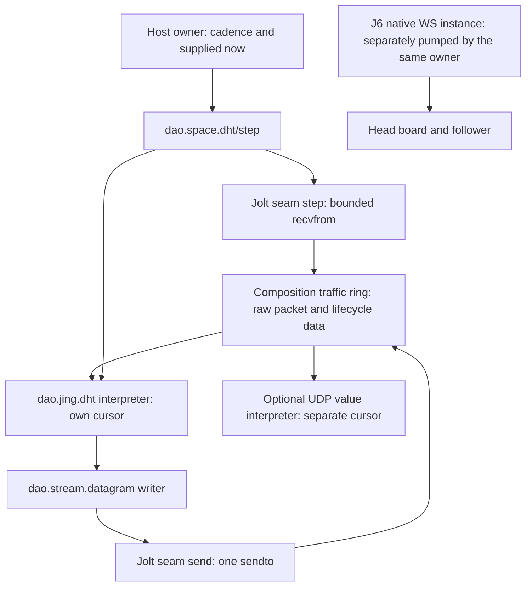

Created-GMT: 2026-11-15 20:14:22 UTC
Created-Local: 2026-11-15 15:14:22 -0500
Coding-Agent: codex
Role: architect
Task: J7 — native UDP and DHT composition on jolt
Base: `1ab4e9e65c48a437c46fce637de0dfc44f6d07ae` (`fix/j7-udp-dht`)
Status: design for implementation; no implementation or runtime acceptance claimed

# J7 design findings

J7 supplies a native datagram host seam and joins the existing DHT, durable
store, linker, and signed-head composition to it. The DHT algorithms, wire,
Jing content representation, and engine/storage boundary remain shared.
J6d supplies useful native socket practices, not a UDP implementation: neither
its TCP queue nor its zero-read-as-EOF rule belongs below datagrams.

The governing sources are
[jolt implementation §§8.3–8.4, 9, 10.1](../../docs/design/yin.repl-jolt-implementation.md),
[DHT §10](../../docs/design/dao.jing.dht.md),
[DHT composition](../../docs/design/yin.repl.dht-composition.md), and
[datagram §§3–7](../../docs/design/dao.stream.datagram.md).
The source observations below describe the base revision. Proposed entries
are explicitly marked; they do not exist yet.

## 1. Current factory and the exact host gaps

There is no `yin.shell.dht/store-spec->store` var in this tree. The requested
factory operation is now `yin.shell.store/checked-spec` and `open`
(`src/cljc/yin/shell/store.cljc:59,69`), dispatching to
`yin.shell.dht/checked-spec` and `open`
(`src/cljc/yin/shell/dht.cljc:240,611`). The only explicit jolt refusal there
is the unconditional throw at `dht.cljc:255`. Do not reintroduce an older
factory or put a DHT arm into `yin.repl.store`.

| Needed surface / consumer | Landed provision and evidence | J7 gap / disposition |
|---|---|---|
| Bind one raw socket: `bind! [options] → seam`, with the exact options in §3 | Portable `dao.stream.datagram/writer` already composes after a `bound` event. `dao.space.dht/node-over` calls the binder at `src/cljc/dao/space/dht.cljc:279`; `bind-step` constructs the writer at `:455`. J0b binds IPv4 datagram sockets through FFI. | Production jolt binder is absent. `default-bind` at `:132` has no jolt arm and its namespace selects the JVM seam via the `:clj` fallback. Select the new jolt seam explicitly, before `:clj`. |
| Nonblocking receive and transport stepping | J0b `src/dev/jolt_udp_probe.clj:107` has an N+1-buffer `recvfrom`; J6d's `src/jolt/dao/stream/ws/pump.jolt` establishes bounded, instance-owned owner-thread work. | Add a bounded per-socket receive turn. No Java receiver thread, ambient registry, or fiber started implicitly by `join`. The existing `dao.space.dht/step` at `:1418` does not service native UDP; add the explicit seam turn described in §3. |
| Immediate whole-packet send: `(send! host port bytes) → outcome` | Datagram writer validates destination/Base64/size and preserves `ok`, `transport-error`, `closed` (`src/cljc/dao/stream/datagram.cljc:278`). J0b `send!` at `:88` binds `sendto`. | Promote the raw evidence into owned production code with syscall indirection for test injection. Report would-block/ENOBUFS as `transport-error` AND `send-failed`. Never borrow `ws.pump/send!`, which accepts queued output. |
| Address family, actual bound address, resource lifetime | `jolt.socket.native` sockaddr, bind, local-address, nonblocking, close and poll helpers are exercised by J0b. `src/jolt/dao/stream/ws/tcp.jolt:40,106,125` supplies literal parsing and cleanup examples. | Add production SOCK_DGRAM creation, IPv4 and IPv6, literal-only resolution, actual ephemeral port, and checked cleanup of partial opens. `native/new-socket` is stream-specific; do not call it for UDP. TCP's parser also accepts `localhost`; the datagram contract does not. |
| Time: `(shell.dht/step session now)` → `dao.space.dht/step` → tick data | Already explicit. `src/cljc/dao/space/dht.cljc:445` derives elapsed nondecreasing readings; the jolt owner passes `System/currentTimeMillis` (`src/cljc/yin/repl/main.cljc:1242`). Native wait/pump deadlines use `jolt.io-poller/clock-ms`. | No new clock in the DHT or adapter. Keep those clock domains separate; never compare an epoch shell reading to a monotonic poll deadline. Preserve tick-only deterministic tests. |
| CSPRNG for node id and per-join cookie root secret | `dao.space.dht/secure-random-bytes` at `:142` falls back to the Java SecureRandom shim on jolt. Qualified `jolt_crypto_random` already exists; `src/jolt/yin/vm/linker/random.jolt:46` wraps it with provenance checking and cleansing. | Add an explicit jolt entropy arm using the qualified provider. Move the small native draw implementation to proposed `src/jolt/dao/posix/random.jolt`; keep `yin.vm.linker.random/rand-bytes` as a delegating compatibility surface. `dao.space` must not require `yin.*`. No new crypto implementation or `dao.host` profile entry. |
| Cookie MAC and canonical hashing | Shared `dao.jing.dht/hmac-blake3` and `cookie-for` (`src/cljc/dao/jing/dht.cljc:164,180`) use Jing BLAKE3. `src/jolt/dao/host/hash.jolt` already supplies the native qualified hashes. | Reuse unchanged. Neither WS SHA-1 nor Ed25519 replaces the cookie MAC. Exercise cookie/source/tick behavior on jolt. |
| Sign/verify a published HEAD trace | `yin.vm.linker.sign/sign-trace`, `verify-trace` (`src/cljc/yin/vm/linker/sign.cljc:179,198`) use canonical envelope bytes with the existing head domain. `src/jolt/dao/host/sign.jolt` supplies Ed25519 seed/public/sign/verify; J4 owns key loading and private key creation. | Primitive exists. Run actual signed-head deposit/follow/tamper tests through composition. Do not change domain bytes, principal identity, or serialize private seeds onto a stream. The local durable HEAD is a manifest pointer; the separately deposited trace is what is signed. |
| Directory store, lock, content replay, atomic HEAD, bounded `heads.edn` | J4 `:jolt` arms in `dao.jing.file` and `dao.space.store.fs` use `src/jolt/dao/posix/file.jolt`: complete writes, sync, atomic same-directory replacement and directory sync, locks, strict bounded UTF-8. `shell.dht/open` opens `durable/open`; `read-heads` at `:340` and follower persistence use the same FS surface. | No new persistence backend. Reuse J4 and test its failures at this composition boundary, including recovery and cleanup. Do not replace it with `spit` or an in-memory HEAD. |
| Announce and publication results | `dao.space.dht/store` inserts locally and records ledger entries; `announce!` at `:424` appends a manifest boundary. `shell.dht/compose` at `:545` wires durable HEAD success, then announce, then trace deposit (`:591–595`). | Already shared, host-free behavior. No host `announce!` syscall or publication callback is needed. Preserve this ordering and separate local durability from later dissemination results. |
| Head-board transport / follower dial | J6e `src/jolt/yin/repl/host.jolt` supplies a fresh `{:connect! :bind! :unbind! :pump :close-host!}` over native WS/TCP; the jolt owner already pumps that same instance for composition endpoints. | `shell.dht/board-codec` at `:882` currently selects `:transit`, absent from jolt's `connect/codec-profiles`. Resolve this explicitly in §4; merely removing the refusal cannot make signed-head following work. |
| Portable UDP value channel sharing the traffic ring | `src/cljc/dao/stream/udp.cljc` already means decoded values, fragments, projections and `port-step!`, not the raw native socket. `datagram.md` §6 keeps its observer independent of the DHT. | The requested `src/jolt/dao/stream/udp.jolt` shadows that namespace. Preserve its complete existing public surface; the mandatory factoring in §2 prevents replacing the value channel with raw-only code. |

J6's `ws/crypto.jolt` already supplies qualified SHA-1 for the WS upgrade and
random masking keys. Reuse the existing native WS host for boards; it is not a
signing API or a source of DHT wire semantics.

## 2. Landing and portability decisions

The production native implementation lands at the requested
**`src/jolt/dao/stream/udp.jolt`**, over `jolt.socket.native` and `jolt.ffi`.
That path implies namespace `dao.stream.udp` and loader shadowing. A raw-only
replacement would silently remove `make-port`, `make-attacher`, fragmentation,
projection and `port-step!`. The implementer must resolve this before adding
the socket code:

1. Factor the existing host-free value-channel functions into proposed
   `src/cljc/dao/stream/udp/common.cljc`. Keep `dao.stream.udp` as the public
   facade on every host. Keep the small `UdpHandle` type and its constructor
   in the public facades, with its append delegating to the shared send path;
   pass its constructor into the shared attacher construction as needed.
   This avoids changing the public type/constructor namespace while keeping
   the protocol implementation shared.
2. Both facades expose the existing constants, functions, arities, constructor,
   outcome maps, and wire keywords. The `.jolt` facade additionally owns the
   raw socket entry `bind!` and native helpers. Do not duplicate the roughly
   500-line protocol implementation into `.jolt`, dynamically load the shadowed
   file, or rename wire keys while moving code.
3. `dao.space.dht`'s existing namespace-local conditional libspec list gains a
   `:jolt` branch selecting `[dao.stream.udp :as datagram.host]` and the narrow
   entropy adapter. Its small `default-bind` and `secure-random-bytes` functions
   gain corresponding reader arms. These are host seams in a large portable
   orchestrator; a whole-file override of that orchestrator would copy DHT
   behavior and is inappropriate.

This is a bounded factoring prerequisite to honor the requested path. It does
not redesign the value channel. API/arity and wire parity plus its existing
tests are its acceptance. An alternate raw-only path would avoid factoring,
but is not the landing selected by this design.

All jolt imports stay inside `.jolt` namespaces or existing `ns` conditional
libspecs at genuine shared host seams. **No top-level conditional `require`,
runtime `resolve`, `load-file`, or overlay.** In particular, do not copy
`a6c25106`'s top-level conditional-require technique: the task explicitly
excludes it. Shared `.cljc` must continue loading on JVM/Node/Dart without
jolt installed. Do not copy `yin.repl`, `yin.shell.dht`, `dao.space.dht`, or
the Jing codec into host overrides.

## 3. Native datagram contract and step ownership

The proposed binder's portable surface is the landed one. The extra `:step!`
entry is explicit host servicing, not a stream operation:

```clojure
;; Proposed jolt binder input; :deposit is a composition-owned evicting ring.
(bind! {:identity id :deposit traffic
        :bind-host "127.0.0.1" :bind-port 0 :max-bytes 1200})
;; => {:send!  (fn [literal-host port host-bytes] outcome)
;;     :close! (fn [] nil)
;;     :step!  (fn [] {:progressed? boolean})}
```

`bind!` completes the native bind synchronously and deposits one `bound` with
the actual address/port before returning, or `bind-failed` after releasing
partially acquired resources. As with other hosts, failed binding yields no
datagram writer. The returned failed seam remains safely closable and cannot
answer a successful send.

`dao.space.dht/step` services an optional `:step!` on its seam once, before
`tick`/`bind-step`/DHT interpretation. Other hosts have no such entry and keep
their existing event ingress. The seam retains only its own descriptor,
closed state and bounded native buffers; callers retain their node values.
No receive callback invokes an interpreter, evaluator, linker, or host ticker.
Raw-seam and UDP-value-channel compositions outside `dao.space.dht` must also
drive that seam turn explicitly before reading their traffic ring.

The receive turn attempts at most 64 packets/syscalls, stopping at would-block
or error. Oversize drops consume this budget too. A flooded socket therefore
cannot keep the owner in an unbounded drain. This is an adapter service bound,
not a new DHT message or stream limit. `:step!` after close is a no-op.

For J7, the existing shell cadence services UDP: 25 ms while busy, backing off
to at most 200 ms while idle (`yin.repl.main/default-cadence`). No additional
thread, global socket registry, WS-pump registration, or UDP-specific logic in
the engine driver is required. The existing native poll wait still yields
between owner rounds; receive itself never waits. Accept up to the existing
idle cadence before ingress is observed; do not promise immediate UDP wakeup.
J0b's separate fiber/readiness/cancellation regression remains required.
Adding UDP interests to the driver's composite poll set is a later optimization,
not permission to omit progress during idle or headless operation now.



### Syscall results and observable outcomes

| Condition | Native result / host action | Datagram writer / traffic observation |
|---|---|---|
| Full `sendto` success, including `n = len = 0` | One complete packet submitted. | `:dao.stream/ok`; no remote delivery or storage acknowledgement implied. |
| EAGAIN/EWOULDBLOCK, macOS ENOBUFS (also Linux ENOBUFS if reported) | Preserve errno and reason; nothing accepted. | Immediate `:dao.stream/transport-error` with `:dao.stream.datagram/reason`, plus one `/send-failed` lifecycle event. No `full`, `refused`, wait, queue, or retry. |
| EMSGSIZE or another send error | Preserve the actual native failure. | Same transport-error + send-failed pair. Configured-size invalidity was already rejected above the syscall. |
| Anomalous short send (`0 <= n < len`) | Error with expected/actual length; never submit the suffix. | Transport-error + send-failed, never successful packet acceptance. Inject this condition separately from natural syscalls; do not claim natural short UDP sends were observed. |
| Interrupted send | Return the native failure for this attempt. | Same failure pair. This design chooses one syscall per send and adds no EINTR retry loop. TCP's EINTR behavior is not imported. |
| Empty nonblocking receive | Raw would-block with errno; finish turn immediately. | No datagram, no EOF, no fabricated lifecycle fact. |
| Receive length `0..N` | Copy exactly the received bytes and observed source into host-owned values. | One `datagram-event` with padded standard Base64; zero-length is `""`. |
| Receive length above N, including a packet exceeding buffer capacity | N+1 sentinel classifies raw oversize/truncation; discard the entire consumed packet. | No successful prefix and no inbound datagram event. §8.3's raw error classification becomes §8.4's below-transform oversize drop, not a send-failed event. |
| Receive interruption / fatal receive error | Stop the turn; retain explicit raw error diagnostics. An interruption leaves the socket usable for the next owner turn. A fatal descriptor error closes it once. | Fatal closure deposits existing `/closed` while possible. Never treat receive error as EOF, invent successful content, or spin on a persistent error. Preserve errno in host diagnostics without inventing a fifth public datagram lifecycle kind. |
| Cross-family destination | Detect before `sendto`; retain usable socket. | Transport-error + send-failed, as the landed contract specifies. |
| Closed writer / seam | Never touch a reused descriptor. | `:dao.stream/closed`; no packet submitted. Closing is idempotent and emits `/closed` once. |
| Bad destination, hostname, Base64, or decoded length above N | Portable writer rejects before the host seam. | `:dao.stream/invalid-value`, zero native sends; not a host send failure. |

The result and `send-failed` are two observations of one failure; events have
no send correlation and must not be counted as a second failed transmission.
The binder receives the deposit writer, never a function to call. Lifecycle
and packet values use existing datagram constructors. Ring gaps remain loss
for each reader's own cursor; no adapter replay or retention is introduced.

### Native details carried forward from J0b

Use target-selected constants (`native/os`) and the probed bindings:

```text
sendto   [int pointer size_t int pointer uint] -> ssize_t, captured errno
recvfrom [int pointer size_t int pointer pointer] -> ssize_t, captured errno
```

`socklen_t` is 32-bit unsigned on both qualified targets; preserve native
sockaddr family/layout helpers and reinitialize receive address length on
each call. SOCK_DGRAM=2, IPPROTO_UDP=17; the probe records EMSGSIZE=40/90,
EAGAIN=EWOULDBLOCK=35/11, ENOBUFS=55/105 for macOS/Linux respectively. Recheck
header evidence when qualifying the current pin. J0b noted upstream `c-bind`
uses same-width `:int`; audit its ABI, not an unrelated upstream rewrite.

Create nonblocking, close-on-exec datagram descriptors directly. Do not take
TCP-only setup (listen, connect, TCP_NODELAY, send-tail queues, or EOF) from
`ws/tcp.jolt`. Use IPv6-only binding for an IPv6 seam so family mismatch
behavior is deterministic; test `127.0.0.1` and `::1`, wildcard binding, and
source normalization without DNS or scoped zone ids. IPv6 syscall and option
evidence is new J7 work: J0b established IPv4 only.

Allocate at least N+1 receive bytes, never N. If a larger datagram is truncated
by `recvfrom`, the returned N+1 sentinel still exceeds the admitted bound;
no `recvmsg`/MSG_TRUNC dependency is necessary. Do not claim the original
packet length when only the sentinel length was observed. Free each sockaddr,
length pointer and byte buffer on every path; establish fd ownership as soon
as socket creation succeeds. Close/cancel/forget any poller state before fd
reuse; do not retry native close after EINTR. Test failed setup after each
acquisition as well as repeated successful bind/close.

The adapter's N is symmetric and configurable, default 1200. DHT currently
binds and constructs its writer using `::dao.jing.dht/max-datagram` from
defaults at `dao.space.dht:285,481`; J7 uses that same 1200 budget. Larger-N
adapter acceptance does not assert a new DHT CLI option. If a DHT override is
exposed, resolve it once into the state, binder and writer before accepting
it. Keep `max-message-bytes` distinct: its effective value already feeds the
store refusal and `payload-budget`; do not replace it with N or hardcode
index page sizes.

## 4. Shell, signed HEAD, and composition order

The current `checked-spec` refusal stays until the production path and board
codec choice are ready. Removing it is the activation step, not the initial
implementation. The final composition is:

1. Parse and validate shell flags/spec, follow principals and explicit publish
   intent. Open the J4 durable directory store under its existing lock.
   Validate recovery and bounded `heads.edn` before opening a follower dial.
2. Join `dao.space.dht` over that local store. With no peers, retain solo mode:
   no socket, no cookie secret, no network work (the current node still mints
   its id). With peers, draw the id and 32-byte cookie secret from qualified
   entropy, bind the native datagram seam and consume its `bound` event before
   constructing the datagram writer. Binding failure refuses the session.
3. Supply the engine only its generic Jing handle, recovery, immutable
   publication policy and generic service media. Keep the node, socket,
   publisher/follower, clocks and scheduling in composition. The engine does
   not own or step transport. Continue using `yin.shell.session` adapters for
   linker/query completions and `shell.query` registrations.
4. Preserve publication order exactly:
   **materialize and read back → atomic durable HEAD success → announce →
   signed trace deposit**. Announce is ledger data serviced by `step`, not a
   synchronous peer wait. Only durable HEAD success promotes the local
   frontier; later dissemination failure cannot roll it back. Failed HEAD
   persistence must cause neither announce nor deposit. Recovery/startup and
   hydration deposit at the existing points; no new publication protocol.
5. A publishing key plus peers plus `publish?` composes the board. Once UDP
   binds to loopback, serve its read-only board over the existing native WS
   instance at **the same numeric port on TCP**, path `/head`. Report a join
   token only after the board endpoint actually binds. UDP bind success does
   not imply TCP bind success. Ordinary publishing without a key retains its
   existing content behavior and has no signed board/token.
6. Step raw ingress, the DHT and its loads/results, then the board and
   follower, using the existing `shell.dht/step` order. Persist a confirmed
   followed trace in `heads.edn` before installing its resolver head. Normal
   following never gates evaluation; explicit pinned hydration validates all
   four indexes and installs recovery before admitting evaluation. Reset,
   rollback and VM switching keep the existing composition service seam.
7. Preserve `stop!` → owner-driven drain via `step` → `stopped?`, with `close!`
   as the bounded drain's last resort. Release dials, board listener, UDP
   descriptor and local store once; keep the traffic ring writable until the
   seam's final lifecycle fact. Startup refusal releases everything already
   acquired without replacing its original reason with a cleanup exception.

### Board codec decision

`board-codec = (:transit connect/codec-profiles)` is not usable on jolt: it is
nil there. Selecting CBOR only in a jolt dial would still fail against the
current Transit-only shell board on another host.

J7 therefore makes **CBOR the common shell-board dial profile on every host**.
Boards serve CBOR first, plus Transit on hosts whose existing profile map
contains it. This can be derived portably from `connect/codec-profiles`:
jolt serves `[cbor]`, JVM/Node/Dart serve `[cbor transit]`. No conditional
require or jolt-specific board implementation is needed. Retaining Transit
on those listeners preserves their existing Transit clients. Updated CBOR
clients talking to an old Transit-only board fail explicit negotiation; J7
does not add fallback negotiation or alter join tokens to conceal it. Qualify
the host matrix at the same source revision and document this dial-default
change in the implementation findings.

Low-level board tests that deliberately exercise Transit stay on the hosts
that provide it; codec-neutral board tests run through CBOR on jolt. Canonical
trace bytes/signatures, principal names, board identity and persisted record
schema do not change with the channel codec. No jolt closure may load
`dao.stream.transit` or `cognitect.transit`.

### Refusals retained after activation

Keep all existing invalid spec, literal/port/size, missing-peer-for-pin/follow,
undeclared principal, corrupt recovery/HEAD/heads file, directory contention,
key validation, bind and hydration failure outcomes. Never open an empty index
after a required recovery or load fails. Publishing remains explicit and
independent of having peers; fetch-only behavior remains enforced.

Non-loopback UDP is governed by the already-landed cookie, amplification and
storage bounds, not a new relaxation. The head board and `:follow` remain
loopback-only; a non-loopback UDP bind can have no board/token. WS remains
`ws://` and CBOR-only on jolt; `wss://` and Transit remain explicitly refused.
Unsupported protocols do not become supported because DHT opens. No simulated
success, sidecar, or renamed JVM socket shim is permitted.

## 5. Implementation slices with falsifiable acceptance

These are J7 subdivisions, not replacement names for the governing J0/J6
slices. Each lands with its own tests/evidence; platform completion is tracked
separately. Keep the shell's blanket jolt refusal through J7c.

| Slice / order | Change boundary | Required acceptance before moving on |
|---|---|---|
| J7a — preserve the portable surface and qualify prerequisites | Factor UDP value code/facades for §2; lower qualified entropy adapter, retaining existing signing entry points. Refresh the J0b baseline on the pinned runtime. | Existing `udp-test`, `udp-raw-test`, `datagram-test` behavior and exported API/arities remain unchanged on JVM/Node/Dart and jolt. The host-free raw/value suites currently excluded as “UDP sockets” actually run. Random draw failure is explicit, no secret or syscall fallback; signing vectors remain unchanged. Clean tracked-root loading on all hosts; no jolt → Transit or dao.space → yin dependency. |
| J7b — native datagram implementation | Raw helpers and binder in `src/jolt/dao/stream/udp.jolt`; bounded owner-driven `:step!`, lifecycle and cleanup. | All §6 J0b legs against production helpers, plus jolt writer/traffic-ring contract tests: IPv4/IPv6 actual-port round trips, source fidelity, invalid-value with zero syscall count, size/drop cases, failure pair, family mismatch, idempotent close, slow-reader gap and two independent seams. Inject EAGAIN/ENOBUFS/short send and count exactly one syscall and one failure event per attempt; subsequent real successful syscall works. No packet appears later from a failed attempt. Bounded flood turn and empty turn return without waiting. |
| J7c — shared DHT host composition | Explicit jolt default binder/entropy selection; optional seam servicing before `dao.space.dht` protocol step. Plain `join`/store/announce/load/query use the existing shared algorithms. | On actual native loopback sockets, small and chunked content exchange, cookies/source matching, lost/reordered/inconsistent chunks, configured inbound bound, fetch-only mode, bind/send failure propagation, and a caller-driven plain `join` load/query pass. Solo opens no fd/secret/pending network work. Local put/readback needs no transport step; failed sends do not count a peer, including failure halfway through a chunk run. Persistent reopen and owner cleanup pass. Retain the existing three-socket fixture; do not substitute a mesh-only result for real UDP. |
| J7d — shell and signed-head activation | Apply §4's board profiles, remove `checked-spec`'s jolt throw, use the existing factory/session/linker composition and J6 WS host. | A real jolt `dht:<dir>` shell publishes, persists HEAD, queries after restart and exits with all resources released. A manifest-pinned reader hydrates before executing pretyped input; signed-name require works on every supported VM. A loopback signed-board follower observes a move, persists it before resolver installation, and restores its rollback floor on restart. Tampering, bad key, HEAD write failure, corrupt heads file, UDP bind failure, TCP-board bind failure, hydration failure and forced shutdown retain their specified outcomes. Re-enable the J7-owned shell per-test exclusions. |
| J7e — parity evidence and closure | Add jolt child roles to the real-process DHT/signed-head harness, and reconcile applicability entries and source-load checks. No new transport implementation. | Complete §7 on macOS arm64 and Linux x86_64: jolt in each relevant role against JVM, Node and Dart, real UDP and native WS boards, executed slow bodies and full summaries. Restore shared deterministic suites, retain eight distinct manifest publications and twenty-round/400-tick idle proof, and demonstrate idle/headless progress without stdin. No open J7 prerequisite is hidden by a skip; unaffected three-host lanes and engine Gate A/B stay green. Record each platform's commands, revisions, counts, outcomes and cleanup. |

J7d may be tested as an activation candidate before committing it; do not ship
a broadly accepted spec whose follow/publish options are silently ignored.
If a platform or required role remains unrun, the implementation can be
reported as partial, but §10.1's J7 gate remains open.

## 6. J0b regressions retained

`bb probe:jolt-udp` already exists (`bb.edn:70`), driving tracked
`src/dev/jolt_udp_probe.{clj,sh}`. Preserve its assertions and diagnostic
records. The old shell wrapper can fall back to an ignored spike checkout;
J7 qualification must explicitly use the bootstrapped tracked toolchain and
record its SHA/clean state rather than relying on that fallback.

| §8.3 leg | Retained proof / evidence required for J7 |
|---|---|
| 1 — boundaries | Nonblocking loopback bind and ephemeral-port readback; exact payload AND source for empty, embedded-NUL, consecutive distinct, and N-sized packets; one receive consumes at most one packet. Inject short send: error, no suffix send and no accepted packet. Repeat through production helpers and the public writer. |
| 2 — bounds | N=1200 and configured N=8192, asserting the latter is below the measured send maximum; N, N+1 and packets larger than the receive buffer. No accepted prefix, consumed oversize packet leaves no remainder. Separately induce above-platform-limit EMSGSIZE and observe no delivery. Preserve platform header/sysctl/MTU and socket-buffer readback evidence. Add IPv6 coverage in J7 without pretending it existed in J0b. |
| 3 — pressure | Raw would-block classification retains errno. Inject target EAGAIN/EWOULDBLOCK and ENOBUFS with zero accepted packets; also exercise actual successful syscalls before/after. Natural pressure trials remain RECORD observations, including packet loss; no requirement to manufacture natural loopback EAGAIN. At the public writer assert transport-error plus send-failed, no `full`, no wait and no replay on later turns. |
| 4 — readiness / cleanup | Keep the distinct raw probe's read waiter: it parks through the poller, another fiber progresses, a packet wakes it, cancel releases it, close/forget removes descriptor state, post-close receive reports EBADF. The harness may wait/retry to make observations; those loops must not enter production `append!` or receive turns. Test production failed-open cleanup, repeated close, no retained fd/native buffers and descriptor reuse separately. |
| 5 — reproducibility | Separate macOS arm64/Linux x86_64 records: repository and runtime SHA, Chez/compiler/native provenance, platform and header constants, exact command/exit, packet sizes/counts, raw error traces, injected vs natural labels, poller traces and final empty ownership state. Missing machine/output is incomplete, not passed. |

Historical evidence exists, not a fresh acceptance result:

- [macOS round 2](1792429967000-engineer-jolt-j0b-udp-probe-r2.claude-opus-5-5.findings.md)
  records 36 passing assertions and three observations on jolt `96d7b866`;
  IPv4 maximum observed there was 9216 bytes.
- [Linux review/sign-off](1792487422000-reviewer-jolt-j0b-linux.qwen3.8-max.findings.md)
  records shiva runs with 37 passing assertions and three observations,
  maximum 65507 and EMSGSIZE 90. The extra assertion is Linux SO_SNDBUF
  readback. Both platforms used injection for send pressure/short-send paths.
- [tracked probe transfer](1792489765000-engineer-jolt-j0b-commit-prep.claude-opus-5-5.findings.md)
  records the move into `src/dev`. The governing table's old J0b
  “probe-only; not merged” label is not evidence the tracked files are absent,
  and the old runs are not datagram/DHT conformance.

Current `jolt-toolchain.edn` pins `b389f1a7fb553f63a3494d71f8fe3251790bf4d3`,
not the probe's historical SHA (nor the older SHA in `src/jolt/README.md`).
Rerun the retained legs at the actual qualified pin on both platforms.
The J6 macOS Autobahn waiver does not waive J7 UDP or signed-head evidence.

## 7. J7 gate mapped to §10.1

| Governing J7 requirement | Concrete gate / evidence owner |
|---|---|
| “§8.4” datagram/address/size/lifecycle integration | J7b: existing `test/dao/stream/datagram_test.cljc`, a new native jolt seam suite/probe, preserved UDP value/raw suites. Check actual ring values, maximum policy, IPv4/IPv6 and observed-source addressing. |
| “J0b regressions retained” | J7a/J7b: every row of §6; retain the separate poller/fiber leg and run native packet/error legs through the production implementation too. Mere copying of the probe or requiring its namespace does not pass. |
| “would-block/ENOBUFS is transport-error plus send-failed” | J7b/J7c: deterministic native injection, exact writer outcome and one traffic event, zero packets accepted and zero later resend; a DHT chunk run cannot count that destination as sent. |
| “no full, no hidden retries” | J7b: syscall counters under pressure/short/error; no outbound buffer/queue or send-side wait; no POLLOUT-driven replay. J7c: existing explicit DHT repair remains above the seam and retains its original retry policy. |
| DHT/linker composition, real processes and signed heads | J7c/J7d/J7e: `dao.space.dht-test`, `yin.vm.linker.dht-test`, `dht-end-to-end-test`, `head-test`, `head-follow-test`, `head-board-test`, `yin.repl.dht-test`, `dht-head-test` and jolt roles in `dht_process_test.clj`. Adapt codec-neutral board fixtures to CBOR on jolt; do not load Transit to make them pass. |
| Bind/send failures and shutdown | J7b/J7d: UDP failure pair and socket ownership; shell refusal for failed UDP bind; failed TCP board yields no token; publication/storage failure ordering, follow persistence failure, graceful drain and forced final cleanup. Zero live UDP/TCP descriptors, dials, owned native buffers and directory lock after close. |
| Host parity; deferral remains incomplete | J7e: independent macOS arm64 and Linux x86_64 records, jolt publisher/reader/follower against each JVM/Node/Dart peer, both directions where roles differ, all using updated CBOR-capable board composition. A JVM test driver is allowed; the deployed jolt child has no JVM/Node helper. Required peer build unavailable is a failed/incomplete gate. |

The process harness is currently JVM-controlled and starts JVM/Node roles
(`test/yin/repl/dht_process_test.clj`); add configurable jolt launch roles
using the tracked `:jolt:jolt-yin-repl` alias rather than porting ProcessBuilder
or the anchor thread to jolt. Include jolt-to-jolt durable publication and
restart, then interop in both storage/load roles. Test `::1` raw transport
separately from any IPv4-specific process transcript regex; changing a regex
does not establish IPv6 transport acceptance.

Reconcile `src/dev/jolt_j2_lane.clj` and
`test/resources/yin/repl/jolt-applicability.edn`: run portable DHT, UDP and
head suites previously excluded for unavailable transport, and remove J7's
per-deftest refusals once their bodies pass. Some exclusions falsely label
host-free suites as “UDP sockets”; they are not substitutes for real-socket
evidence, but they should not remain skipped. Genuine JVM/Node/Dart host
fixtures may stay in their own lanes with precise capability reasons and
the native jolt equivalent named. Do not blanket-delete other tracks' entries
or declare their capabilities supported by a J7 label.

Preserve the DHT-composition spec's stronger retained proofs: eight **distinct
manifest addresses**, the twenty-round/400-tick idle fixture, corruption and
recovery, and follow persistence. Neither timing relaxations nor acknowledgement
timestamp counts replace those assertions. Keep engine Gate A's zero backend
references and Gate B's injected non-DHT storage suites: no backend knowledge
is added to `yin.repl`, and no network waiting is added to local publication.
Shared-source and facade factoring changes require the affected JVM/Node/Dart
lanes in addition to jolt. J8 still owns full repository lane qualification;
J7 cannot defer its own datagram/DHT acceptance to J8.

## 8. Explicitly out of scope

- Multi-peer testnet topology design, deployment/orchestration, large-network
  routing experiments and availability campaigns. Required bounded loopback
  fixtures, including the existing three-socket test and ack-peers process
  scenarios, remain acceptance tests; this exclusion does not remove them.
- NAT traversal, hole punching, STUN/TURN, meeting services, automatic public
  address discovery, DNS resolution, and scoped IPv6 zone ids. A bind address
  does not become an advertised reachable address.
- A new DHT protocol, routing algorithm, chunk wire, cookie scheme, reliability
  layer or UDP outbound queue; changing replication/repair thresholds without
  the existing measurement proof; new index/manifest/heads schemas.
- WS TLS, Transit on jolt, browser transport, Windows qualification, sidecars,
  a replacement file store or handwritten signing/hash primitives.
- Broad engine refactoring, a new host entropy profile, immediate UDP wakeup
  optimization, or a new universal transport runner. The explicit seam turn
  and small host-code factoring above are sufficient for this slice.

## 9. Design verification and implementation handoff

Read the requested governing sections and traced their present factory,
datagram writer, native TCP/pump, crypto/entropy, durable filesystem, board
codec, process harness and applicability boundaries at the recorded base.
The principal findings are the absent production UDP seam/step, the namespace
collision at the requested landing path, the unqualified entropy fallback,
and the Transit-only shell board selection. All have concrete dispositions
and acceptance above.

This artifact changes no source or test behavior. No transport, remote host,
or runtime suite was executed for this architecture round; historical results
are attributed in §6 and all J7 acceptance remains prospective. Artifact
validation checks relative Markdown links, existing versus explicitly proposed
source paths, balanced code fences and whitespace; cited source boundaries
were checked against the base. The implementation findings must report actual commands, counts, failures,
platform gaps and the final applicability changes, rather than treating this
design as a network-parity sign-off.
